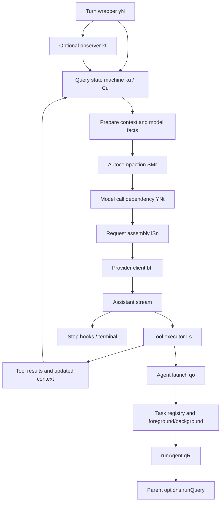

# Claude Code 2.1.310：Agent 循环、模型、上下文与子任务静态调查

## 证据边界

只读取本次已提取的发行物 JavaScript，没有执行提取 JS、没有读取用户配置、会话或凭据，也没有请求网络。下列字符范围使用 `/tmp/claude-code-analysis/ast-index.json` 的 0 基、结束不包含字符位置；模块编号是分析合成编号，不是 Anthropic 源文件名。原始二进制位置与摘要由 `extraction-manifest.json` 定位。观察是“代码中有这条路径”，不代表本机运行时启用了路径。变量为压缩后的原始标识符，不能视为源码模块名称。

## 1. Agent 的核心：可注入依赖的异步生成器状态机

**事实 A1**：`module-745.js:yN[139763,140708)` 是 turn 包装入口。它接收 messages、querySource、toolUseContext 等，运行 `PJe(options.tools)`，然后在 `OFn()` 条件下选择 `kf` observer 包装或 `s.through(ku(...))`。finally 对 subagent 触发 precompute 清理，再处理 command lifecycle 与 turn 完成计量。`kf[140708,141599)` 创建 observer tap，逐条 `next()`/yield 透传，并在结束时 finish。这说明 UI/SDK 可消费统一事件流，观察器是包裹执行的可选层。

**事实 A2**：`ku[142239,215239)` 在初始阶段构造 K：`{guards:{...zs,...,turnCount:1},messages,toolUseContext,compactTracking,transition}`；结尾是 `while(!0){let b=yield*Mu();if(b!==Ao)return b}`。`Ao="next_round"`；`Cu[146083,214934)` 执行一轮，返回 terminal 对象或改写 K 并返回 Ao。故尽管日志名为 `query_recursive_call`，当前可见实现是状态机迭代，不是每轮无限加深 JS 递归栈。

**事实 A3**：`Dd[126226,126319)` 返回 `{callModel:YNt,autocompact:SMr,uuid:Xm,now:()=>new Date().toISOString()}`，`ku` 使用 `e.deps??Dd()` 再装饰依赖。模型调用、压缩、时钟和 UUID 均通过依赖对象到达主循环。`module-745.js[615,1900)` 从 `chunk-31gxg38t.js` 导入 YNt/SMr，`module-499.js` 尾部导出同名；后者含这两个函数体。

**事实 A4（请求前）**：`Cu[146083,155409)` 从 compact boundary 后取可见消息、合并 arriving rows、内容替换、处理 live model switch、加载 model facts、自动压缩、更新上下文渲染与工具描述，建立 `contextRoom`。片段：`let j=[...ks(ze)];j=r.withArrivedRows(j)`；`D.autocompact(j,b,Ct,...T,pt...)`；`b={...b,messages:j,turnStartIndex:Br(j),contextRoom:Wa(...)}`。因此主循环不只是把历史原样发给 LLM；它在每轮发请求前重新构造有效上下文。

**事实 A5（流式请求与工具重叠）**：`module-745.js[167540,169900)` 为 `for await(let w of cl(ta({messages,...systemPrompt,...tools,signal,...options:{model:ve,modelFacts:Ct,...fallbackModel,...}})))`，ta 来自 D.callModel。`[186700,187250)` 在 assistant 中提取 tool_use，设置 `needsFollowUp=!0`，逐个 `Ce.streamingToolExecutor.addTool(Ue,de)`，随后 `yield*Wn()`。工具可在模型响应流处理期间入队；并非所有调用都要等最终文本完成才开始。

**事实 A6（执行调度）**：`Ls[53672,63675)` 是工具流执行器。addTool 用 schema.safeParse 检查输入，再查询工具 `isConcurrencySafe`；`canExecuteTool` 允许无其他 executing 工具时运行，或新旧工具都 concurrency safe 时并行。`processQueue` 对不安全工具遇阻时 break。任务状态为 queued/executing/completed/yielded；discardAndAbortInFlight 对执行中工具中止、保留完成结果、列出未开始工具。用此可以区分“模型生成多个 tool_use”和“实际允许并行执行”。此类是产品调度代码，不是仅由公共 Promise/SDK 库名称推测。

**事实 A7（下一轮与终止）**：`module-745.js[205300,215239)` drain RemainingResults，收集 tool result 与 newContext；检查 aborted、tool_deferred、hook_stopped、工具请求 end turn、maxTurns；最后写入 `messages:[...j,...ne,...rt]`、`transition:{reason:"next_turn"}` 并回主循环。无 follow-up 时走 `ji[202354,...]` 的 stop hooks；blockingErrors 可重新加入消息并再次执行，但存在 stop hook cap（默认代码表达式 8）与 maxTurns。

**事实 A8（受限恢复）**：`module-745.js[194650,202354)` 有不同状态转换：prompt too long/image error → reactive compaction retry；max output tokens →恢复未完成 thinking 或追加恢复提示；stop_reason=tool_use 却无可解析调用 → malformed tool use retry；仅 thinking 无可见回答 → thinking only retry；重试耗尽返回明确错误。另有模型可用性、拒答与 consent 分支。不能由代码存在推断每个账号都启用这些功能。

## 2. 模型适配并非散落在工具中，而是统一客户端与 model facts

**事实 M1**：`module-499.js:_c[931934,932456)` 返回模型事实对象：model、contextWindow、maxOutputTokens、canonical、settingsKey、长上下文与 1m opt-in、bytesPerToken、thinking supported/alwaysOn/rejectsDisabled/capsEffortWhenDisabled、acceptsTemperature。`module-745.js:OPt[64977,65468)` 可等待客户端数据 promise（带超时与取消），最终返回 `_c(e)`。因此上下文上限和 thinking 能力不是只能从硬编码模型名猜测。

**事实 M2**：默认 callModel 的链路是 `YNt[2761795,2762085)` → `wSn[2777153,2777801)` → `lSn[2777801,2901631)`。YNt 以 Pze/Cze/TZe 包装，捕获 wO 并产出 model_fallback_triggered。wSn 捕获工具搜索不可用类型后，重建提示并重试 lSn；lSn 解析 fallback、模型限制、规范化请求与缓存策略等。不能把此大型函数里的所有分支都称作当前启用功能。

**事实 M3**：`module-499.js:j_r[2763507,2766776)` 创建客户端是 `bF({maxRetries:0,model,...agentContext,...})`，之后调用 `Q.beta.messages.create({...pcn(xe),stream:!1},{signal,...timeout})`。此为可见非流式请求适配分支；同大模块同时含流式路径，本调查未穷尽每种 dispatch transport。

**事实 M4**：`module-231.js:bF[262499,272100)` 用 `Od(model)` 路由并创建真正 provider client，条件分支明确返回：gateway → ATe；bedrock → 动态 import AnthropicBedrock；foundry → AnthropicFoundry；anthropicAws → AnthropicAws；anthropicGoogleCloud → AnthropicGoogleCloud；mantle → AnthropicBedrockMantle；vertex → AnthropicVertex；默认 → ATe。分支内分别构造 region、auth token/credential resolver、headers、baseURL 和 fetch override。外层给 agentId、parentAgentId 与请求来源等添加上下文 header。仅记录机制，未读取任何实际凭据。

**推断 M5**：从 `Cu → D.callModel → YNt → ... → bF` 和主循环对 model facts 的使用可推断：Agent 执行层通过共同 Anthropic 风格消息/工具契约隔离不同云 provider，provider 适配层负责认证、地址与 SDK。不是每个工具各自管理一套模型客户端。完整 import 重定位依赖原始 chunk 名映射，模块编号本身不具有映射意义。

## 3. Context / Compaction：阈值、摘要、保留记录、反复填满保护

**事实 C1**：`module-382.js:ks[3856,3913)` 可见实现是先找最后 compact_boundary，存在时 `e.slice(n)`；主循环调用 ks 建立当前推理历史。compact boundary 是一等系统事件，非单纯 UI 文案。

**事实 C2**：`module-499.js:SMr[2575475,2580181)` 为默认自动压缩调度器。它检查 idle precompute、尝试较大摘要模型分支、DISABLE_COMPACT、连续失败 breaker、阈值判定以及固定前缀过大；可返回 not_needed / compacted / failed / hook_blocked / rapid_refill_breaker_tripped 等。配置窗口参与判断；`mne[1522506,1522760)` 使用有效模型窗口与 enabled/config threshold 计算预算状态。不能给出一个适用于所有模型与设置的固定“到百分之几必压缩”。

**事实 C3**：`yMr[2544409,2550321)` 是全量压缩可见实现。运行 FMe PreCompact，合并自定义指令，构造摘要请求 dt，并调用 wmn。遇 prompt too long 可由 gmn 丢掉头部再试；空摘要或 API error 明确失败。成功后清理 readFileState 和 memory selector，重建 attachments/hookResults；构造 boundaryMarker、`isCompactSummary:!0` 摘要消息，计算前后 token，并运行 QNt PostCompact。返回 `{boundaryMarker,summaryMessages,messagesToKeep:[],attachments,hookResults,...}`。这证明压缩由额外模型请求生成摘要，且会协调本地读文件记忆与 hooks。

**事实 C4**：`xB[2542169,2542305)` 将压缩结果组装为 `[boundaryMarker,...summaryMessages,...replacement??[],...messagesToKeep,...attachments,...hookResults]`。主循环 compacted 分支 `module-745.js[149850,151900)` 使用 xB、重做 routing 并发出对应事件。其他 compaction 分支可保留 messagesToKeep；不能把全量压缩函数里空数组推广到所有压缩方式。

**事实 C5**：`module-499.js[1522910,1523540)` 的 PXt=3；J3o 检查前次 compact 后 turnCounter<3，累计 consecutiveRapidRefills；vPr 在 >=3 时 trip。主循环同时对 proactive 和 reactive 分支处理该 breaker。因此反复短时间内把上下文重新填满会停止盲目自动摘要，并给出大文件/大输出提示。

**事实 C6**：`module-745.js[194650,198450)` 的 reactive 路径允许从 precomputed 摘要或一次新的压缩恢复请求，跟踪 hasAttemptedReactiveCompact、reactiveCompactDeeperPass，失败后透出 prompt too long/image error。`module-499.js[2590000,2590800)` 的预计算摘要再利用会检查 precomputedAtUuid、preserve UUID 是否仍在历史、历史是否缩水太多。这是防止复用与当前会话不匹配摘要的静态证据。

**未知**：memory recall/context 内部索引器算法、所有 microcompact/工具输出剪枝算法、服务端实际 tokenizer、缓存命中与真实摘要质量均未在本次调查验证。可见 bytesPerToken 预算估计不等于精确服务端计数。

## 4. Subagent / Task / Background：同一查询接口，独立任务生命周期

**事实 S1**：`module-692.js:dXt[46215,...]` 注册 Agent tool：`name:ht`、`aliases:[dp]`、`backgrounding:"self"`；create.call 要求 `runEngine`，以 `runEngine(qo,{agentInput,...})` 进入 launch handler。`qo[16201,46215)` 解析 subagent_type、run_in_background、isolation、cwd、model、effort，校验递归深度、agent 停止状态、allowedAgentTypes 与权限。命名 teammate roster 的限制、fork 限制都是实际 if/throw 代码，不只是工具描述文案。

**事实 S2**：`module-692.js:bo[5724,6039)` 计算 effectiveIsolation / isRemoteLaunch / shouldRunAsync，把背景默认策略、显式后台选项与 backgroundTasksDisabled 合并。`qo[37000,40500)` async 分支调用 Dle 创建任务；构建 agentContext（agentId,parentAgentId,depth,parentSessionId,isAsync,isBackgroundAgent,invocationKind 等），然后 `cI(...()=>...pte({makeStream:()=>qR(...)}))`。sync 分支使用 UDs 和同一个 qR，区别在等待、后台切换与取消管理，不是另起一套推理模型。

**事实 S3**：`module-499.js:Dle[4889218,4890283)` 在 taskRegistry 注册 local_agent、running 状态，并保留 ownerAgentId、parentAgentId、spawnDepth、selectedAgent、abortController、pendingMessages、keepaliveReasons、isBackgrounded 等。`UDs[4890874,4891916)` 创建 foreground task，建立 backgroundSignal Promise、父取消中继与可选 autoBackground timer。background 不是单个布尔 UI 标志，有可独立追踪的生命周期。

**事实 S4**：`module-680.js:qR[87345,112742)` 被 `module-1677.js` 重导出为 `runAgent`（该文件末尾 `qR as runAgent`）。它合并 fork context 与 promptMessages，选择模型，决定 abort controller，构造 permissions/tools/userContext/systemContext；`[107800,108300)` 调用 `lt.options.runQuery({messages:Te,systemPrompt:_s,userContext:Mt,systemContext:st,canUseTool:y,toolUseContext:lt,querySource:x,maxTurns:Q??e.maxTurns,...})` 并迭代事件。子 agent 继承父 options.runQuery（`[100500,100900)`），由此证明共享查询引擎接口。没有独立证明全部 runQuery 调用点都绑定 yN，故宜写“复用父查询引擎接口”，而不是无条件断言所有 worker 都直接调用 yN。

**事实 S5**：qR 开头 `[87345,91200)` 使用 `Ft=v?bfo(v):[]; Te=[...Ft,...n.map(...)]` 组装 fork 历史，fork 会使用复制/过滤后的历史；没有 fork 则以新 prompt 开始。其权限逻辑会阻止未经父会话授权扩大 bypassPermissions 等模式。因此子 agent 复用上下文/能力时仍有策略边界。

**事实 S6**：`module-1776.js:Qe[12924,24321)` 为 in-process teammate runner。构建 agentType:"teammate" context；`[16442,18450)` 在 lifecycle abort 前循环处理提示，过阈值时 yMr 压缩自己的历史，调用 qR 并消费事件；空闲阶段读取 mailbox、新消息或 shutdown request，idle_timeout 可退出。它确实是长生命周期的同进程协作者路径，区别于一次性同步 subagent；存在路径不代表本机启用了团队功能。

**推断 S7**：产品把“模型轮次”“工具执行”“任务生命周期”“团队消息”拆成不同状态机：query 负责生成/工具反馈循环，Ls 负责工具并发和 drain，taskRegistry 负责运行中/后台/停止与归属，teammate runner 负责持续等消息。这种分层可支持同一 Agent tool 在前台、后台和团队模式间运行。

## 5. 可用于总文档的最小流程图

图中 E 可不需要压缩；H 的完整流式 transport 未逐分支追踪；P 是已验证接口连接，不能当成每次均绑定 A 的证明。

## 追加：runQuery 绑定证据

**事实 S8**：`module-1892.js[1496000,1496500)` 在交互会话 options 对象中设置 `isNonInteractiveSession:!1,runQuery:yN`；`module-1920.js[398650,399100)` 在非交互会话对象中设置 `isNonInteractiveSession:!0,runQuery:yN`。结合 qR 复制父 `r.options.runQuery` 并迭代调用，可把交互/非交互主入口 → 子 agent 的共享查询引擎连接到 yN。此结论适用于这两个已检视构造点，其余专门运行模式仍未穷尽。
